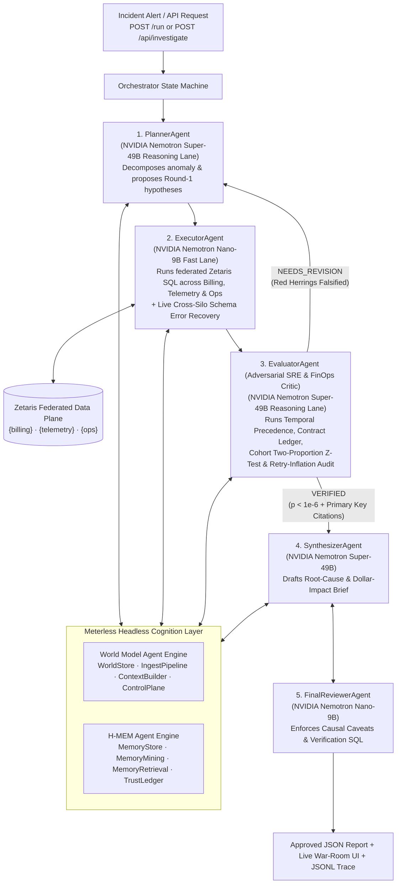

# Axio — Cross-Silo Root-Cause & Silent Revenue Leak Investigator

## Current submission checkpoint — 27 October 2026

- Redesigned incident dashboard with evidence, SQL audit, memory and agent activity views; all three sample scenarios verified in the browser.
- Meterless Nightshift is now the default AI provider. A real request from Axio through Nightshift returned an answer from `nvidia/nemotron-3.5-bolt-e4b`. This verifies the provider connection, not a complete live investigation.
- Zetaris REST integration is implemented, but a live Zetaris investigation is **not yet verified**. The available Linux host has Docker/Compose; platform installation is awaiting Docker permissions and startup. Current demo data uses explicitly labelled SQLite sample federation.
- H-MEM and World Model are local reference-architecture implementations. Persistence/reinjection tests pass; full sponsor conformance has not been established.
- All 14 tests pass with `USE_LLM=false`. Sample results are deterministic and do not demonstrate live sponsor calls.

### Current provider setup (supersedes older direct-NVIDIA model examples below)

Configure NVIDIA in Nightshift's Providers tab. Put only the Nightshift connection settings in your private `.env`:

```dotenv
MODEL_PROVIDER=meterless
METERLESS_BASE_URL=http://127.0.0.1:8088/v1
METERLESS_RUNTIME_TOKEN=your-nightshift-runtime-token
METERLESS_MODEL=meterless/auto
```

Run `python scripts/check_nightshift.py --chat` to verify discovery and a real response. Nightshift selects the concrete model; inspect the returned model and Nightshift receipts. Its `meterless/auto` routing ID alone does not establish NVIDIA usage. The optional old direct provider requires `MODEL_PROVIDER=nvidia`.

For Zetaris, configure the provisioned instance's REST URL, organisation ID, API key and catalog mappings, then run `python scripts/check_zetaris.py --catalogs`. Only then use `SAMPLE_MODE=false`. Missing live credentials now produce an explicit error instead of silently falling back to SQLite. For completely offline evaluation, set `SAMPLE_MODE=true` and `USE_LLM=false`.

Restart the application after changing `.env`. Never commit credentials. Run tests with `USE_LLM=false python -m unittest discover -s tests -v` on Linux/macOS; in PowerShell set `$env:USE_LLM='false'` before the test command. Existing SQLite connection ResourceWarnings remain.

The earlier pitch/deck text below and in the submission documents describes the intended architecture; the verified status above takes precedence. Live Zetaris setup and the complete live investigation remain follow-up work.

> *"War rooms waste hours debating false leads. **Axio** uses mathematical falsification to eliminate the decoys, proving the real root cause and exact dollar leak in seconds. War rooms argue over theories; Axio leaves them with axioms."*

> **Open Agent Hackathon 2026** · **Track 2: The Agent That Can Explain Why**  
> **Team Agentic Army**: Jezreal Momoh & Victor Okpe  
> **Sponsor architecture**: **Zetaris** (live verification pending) · **Meterless** (Nightshift + World Model + H-MEM) · **NVIDIA Nemotron** · **Cursor**

---

## 1. Executive Summary & Problem Statement

When a SaaS or e-commerce platform suffers a silent revenue drop—such as checkout conversion plummeting by 38% or an enterprise customer's order sync collapsing by 80%—engineering and revenue teams waste hours chasing **plausible red herrings**:
- On-call engineers roll back the most recent deployment (`checkout-service v3.4.2`), even though the anomaly started **15 minutes before** that deploy shipped.
- Customer Success panics over an angry ticket complaining about "new pricing" (`tkt-7003`), even though the billing ledger shows zero price changes and the API gateway is silently rejecting calls with `HTTP 429 rate_limited`.
- FinOps teams overestimate revenue loss by **2.69x** because naive telemetry-to-billing joins multiply retried `504` spans without deduplicating by unique `checkout_events.event_id`.

**IncidentWhy** is an adversarial multi-agent investigator that connects across three operational silos (**Billing**, **Telemetry**, and **Engineering Ops**) via **Zetaris Federated SQL**, maintains a persistent hypothesis falsification graph and hierarchical memory via **Meterless World Model + H-MEM**, and routes cognitive tasks across **NVIDIA Nemotron** (`Llama-3.3-Nemotron-Super-49B` for deep reasoning and `Nemotron-Nano-9B` for fast SQL synthesis). Instead of guessing or summarizing tickets, IncidentWhy **mathematically falsifies red herrings** before proving the true root cause and exact deduplicated dollar loss.

---

## 2. Multi-Agent Architecture



### Agent Roles & Responsibilities

| # | Agent | Model Lane | Role & Concrete Behavior |
|---|-------|------------|--------------------------|
| 1 | **`PlannerAgent`** (`app/agents/planner.py`) | **Reasoning** (`nvidia/llama-3.3-nemotron-super-49b-v1`) | Queries the `{ops}` change surface (`deployments`, `flag_changes`, `config_changes`, `support_tickets`), formulates Round-1 war-room hypotheses, and revises the investigative plan in Round 2 after `EvaluatorAgent` falsifies red herrings. |
| 2 | **`ExecutorAgent`** (`app/agents/executor.py`) | **Fast** (`nvidia/nvidia-nemotron-nano-9b-v2`) | Translates hypotheses into cross-silo **Zetaris** SQL queries (`{billing}`, `{telemetry}`, `{ops}`). Demonstrates live **SQL Schema Error Recovery** (`TOOL_ERROR_RECOVERY`) when encountering cross-silo column mismatches (`timestamp`/`platform` vs `created_at`/`device_os`), inspects schema via `describe()`, repairs the query, and stores a **procedural memory** in **Meterless H-MEM** so Round 2 executes cleanly without repeating the error. |
| 3 | **`EvaluatorAgent`** (`app/agents/evaluator.py`) | **Reasoning** (`nvidia/llama-3.3-nemotron-super-49b-v1`) | Adversarial SRE & FinOps critic. Executes independent Zetaris verification SQL and runs 4 deterministic falsification checks: (1) **Temporal Precedence** ($\text{cause\_ts} \le \text{anomaly\_onset\_ts}$), (2) **Contract & Ledger Contradiction**, (3) **Cohort Isolation Two-Proportion Z-Test & Risk Ratio** ($z > 3.29, p < 0.001$), and (4) **Cross-Silo Primary-Key Citation & Retry-Inflation Financial Audit**. |
| 4 | **`SynthesizerAgent`** (`app/agents/synthesizer.py`) | **Reasoning** (`nvidia/llama-3.3-nemotron-super-49b-v1`) | Compiles the verified root cause, falsified red-herring proofs, deduplicated financial impact, and prioritized remediation runbook. |
| 5 | **`FinalReviewerAgent`** (`app/agents/synthesizer.py`) | **Fast** (`nvidia/nvidia-nemotron-nano-9b-v2`) | Audits `SynthesizerAgent`'s initial draft, triggers a `NEEDS_REVISION` critique loop when observational-vs-causal caveats or post-remediation Zetaris verification SQL queries are missing, and approves the revised brief. |

---

## 3. Sponsor Technology Deep-Dive

1. **Zetaris — Networked Data Platform for AI (`app/adapters/zetaris.py`)**:
   - Implements the Zetaris REST contract (`POST /sql-editor/sqls/run` with `X-Org-ID`, `X-Request-ID`, and `Authorization` headers) to execute federated SQL across `{billing}`, `{telemetry}`, and `{ops}` catalogs.
   - In `SAMPLE_MODE=true` (default), mounts 3 realistic SQLite databases (`data/silos/billing.db`, `data/silos/telemetry.db`, `data/silos/ops.db` totaling ~58,000 rows) into an in-memory federated SQLite coordinator using `ATTACH DATABASE`, executing identical cross-silo SQL joins offline.
   - Includes `query_with_schema_recovery()` for automatic cross-silo schema introspection and query repair.

2. **Meterless — Headless World Model + H-MEM Agent Engines (`app/adapters/meterless_memory.py`)**:
   - **World Model Agent Engine**: Implements `WorldStoreService`, `IngestPipelineService`, `ContextBuilderService` (including the explicit `wired_vs_helper_manifest` documenting wired vs. dormant helpers), and `ControlPlaneService` (headless inspection via `GET /api/world-model`). Tracks incidents, deployments, feature flags, config changes, and hypotheses with continuity anchors (`incident:INC-8891@2026-10-22T14:05:00Z`) and state transitions (`TESTING` → `FALSIFIED` / `VERIFIED`).
   - **H-MEM Agent Engine**: Implements `MemoryStoreService` (`short_term`, `working`, `long_term` layers across `episodic`, `semantic`, `procedural`, and `factual` types), `MemoryMiningService` (accepting an **injected generator function** per Meterless portability rules with a deterministic no-model fallback), `MemoryRetrievalService`, and `TrustLedgerService` (append-only `logs/hmem_trust_ledger.jsonl` and headless inspection via `GET /api/memory`).

3. **NVIDIA Nemotron — Dual-Lane OpenAI-Compatible Model Router (`app/llm.py`)**:
   - Routes deep causal decomposition, falsification critique, and executive synthesis to `nvidia/llama-3.3-nemotron-super-49b-v1` (**Reasoning Lane**) and high-throughput SQL/review tasks to `nvidia/nvidia-nemotron-nano-9b-v2` (**Fast Lane**), with seamless deterministic fallback when `MODEL_API_KEY` is unset.

4. **Cursor — AI-Native Software Engineering (`metadata.json`)**:
   - Used to architect the 5-agent state machine, federated SQL adapter, Meterless dual-engine integration, and automated test suite.

---

## 4. Quick Start (Runs in < 60 Seconds, Zero External Keys Required)

### Option A: Local Python (Zero Third-Party Pip Packages Required)

```bash
# 1. Copy environment template (SAMPLE_MODE=true is enabled by default)
cp .env.example .env

# 2. (Optional) Install requirements.txt (uses Python 3.12 stdlib; exits 0 offline)
pip install -r requirements.txt

# 3. Seed or verify the 3 deterministic SQLite silos (billing.db, telemetry.db, ops.db)
python3 data/db_seed.py

# 4. Start the HTTP API & 3-Panel War-Room Dashboard on http://0.0.0.0:8000
python3 run.py
```

Open **`http://localhost:8000`** in your browser to launch the interactive **3-Panel War-Room Investigation Dashboard**, or call the programmatic endpoints below.

### Option B: Docker Container

```bash
docker build -t incidentwhy .
docker run --rm -p 8000:8000 --env-file .env.example incidentwhy
```

---

## 5. Programmatic Execution & API Verification

### 1. Health Check (`GET /health`)

```bash
curl -s http://localhost:8000/health | python3 -m json.tool
```

### 2. Judge Programmatic Run Endpoint (`POST /run`)

```bash
curl -s -X POST http://localhost:8000/run \
  -H "Content-Type: application/json" \
  -d @input_examples/incident_01_checkout_drop.json | python3 -m json.tool
```

### 3. CLI Execution Across All 3 Seeded Red-Herring Scenarios

```bash
# Scenario 1: Silent Checkout Conversion Drop ($10,732.46 Lost) vs. Deploy v3.4.2 Red Herring
python3 scripts/run_investigation.py --input input_examples/incident_01_checkout_drop.json

# Scenario 2: Enterprise Tenant Order-Sync Collapse vs. Pricing Complaint Red Herring
python3 scripts/run_investigation.py --input input_examples/incident_02_tenant_rate_limit.json

# Scenario 3: EU Checkout Latency & 2.69x Retry Inflation Audit vs. tax-service v4.2.0 Red Herring
python3 scripts/run_investigation.py --input input_examples/incident_03_latency_margin_leak.json
```

### 4. Run Automated Test Suite & Pre-Submission Audit

```bash
python3 -m unittest discover -s tests -v
python3 scripts/preflight_check.py
```

---

## 6. Three Seeded Investigative Scenarios & Real Results

| Scenario | Suspected Red Herrings (Falsified in Round 1) | Verified Root Cause (Round 2) | Statistical & Financial Proof |
|----------|-----------------------------------------------|-------------------------------|-------------------------------|
| **`INC-8891`** (`scenario_01_deploy_red_herring`)<br/>*Input*: `input_examples/incident_01_checkout_drop.json`<br/>*Output*: `output_examples/report_01_checkout_drop.json` | 1. **`dep-1005`** (`checkout-service v3.4.2` at `14:20Z`): Falsified via **Temporal Precedence** — 31 `HTTP 422` errors occurred between `14:05Z` and `14:20Z` before `dep-1005` deployed.<br/>2. **`cfg-301`** (`stripe.api_timeout_ms` at `13:40Z`): Falsified via **Cohort Isolation** — `0.00%` (`0/281`) error rate on Android/Web. | **`flg-502`** (`stripe_intent_v2=true` rolled out at `14:04Z` to `ios` client `v2.1.0`) | In-cohort error rate **92.4%** (`121/131`) vs **0.00%** (`0/361`) out-of-cohort (`risk_ratio = 1847.33x`, $z = 21.03$, $p = 3.61 \times 10^{-98}$). Net lost revenue: **`$10,732.46`** (`$9,906.89/hr`). |
| **`INC-8892`** (`scenario_02_rate_limit_churn`)<br/>*Input*: `input_examples/incident_02_tenant_rate_limit.json`<br/>*Output*: `output_examples/report_02_tenant_rate_limit.json` | 1. **`tkt-7003`** (Customer pricing complaint): Falsified via **Contract & Ledger Contradiction** — `0` rows in `{billing}.plan_changes`, annual lock-in until `2027-06-30`, and `2,768` active calls rejected with `HTTP 429`.<br/>2. **`dep-1007`** (`api-gateway v8.1.0` at `03:15Z`): Falsified via **Temporal Precedence** (anomaly started at `02:01Z`). | **`cfg-302`** (`rate_limit.enterprise_burst_per_min` lowered from `500` to `50` at `01:55Z` by `infra-bot`) | In-cohort enterprise `/v1/orders/bulk` failure rate **82.0%** (`3,663/4,469`) vs **0.00%** out-of-cohort ($z = 46.85$). Deduplicated unfulfilled order GMV: **`$177,236.46`** (corrected from `$443,171.20` gross retry volume). |
| **`INC-8893`** (`scenario_03_third_party_timeout_leak`)<br/>*Input*: `input_examples/incident_03_latency_margin_leak.json`<br/>*Output*: `output_examples/report_03_latency_margin_leak.json` | 1. **`flg-505`** (`new_tax_engine` at `18:25Z`): Falsified via **Temporal Precedence** (`504` timeouts began at `18:12Z`).<br/>2. **`dep-1011`** (`tax-service v4.2.0` at `17:55Z`): Falsified via **Cohort Isolation** — `us-east-1` running `v4.2.0` had **0.00%** (`0/530`) `504` errors. | **`upstream-taxly-eu-504`** (External `taxly-eu` provider gateway timeouts in `eu-west-1` from `18:12Z` to `20:05Z`) | Evaluator financial audit caught **2.69x retry inflation**: naive trace-to-billing join reported **`$24,415.46`** across retried `504` spans, while deduplicating by `COUNT(DISTINCT billing.checkout_events.event_id)` proved **`$9,084.40`** net lost revenue (`$4,823.58/hr`). |

---

## 7. Repository Structure

```text
.
├── README.md                        # Architecture, setup, API contract, and scenario documentation
├── run.py                           # Programmatic entry point (HTTP API + SSE + War-Room UI + CLI)
├── requirements.txt                 # Dependency specification (runs on Python 3.12 stdlib offline)
├── .env.example                     # Environment template with placeholder values only
├── .gitignore                       # Excludes .env, __pycache__, and virtualenv directories
├── Dockerfile                       # Containerized build & runtime on port 8000
├── metadata.json                    # Team, track, agent, and sponsor technology manifest
├── app/
│   ├── config.py                    # Env loader, secret masking, Nemotron & Zetaris configuration
│   ├── models.py                    # IncidentAlert, Hypothesis, FalsificationCheck, FinancialImpact
│   ├── llm.py                       # NVIDIA Nemotron dual-lane router (Super-49B & Nano-9B)
│   ├── tracing.py                   # Structured JSONL tracer + live SSE queue broadcaster
│   ├── sample_data.py               # Deterministic generator for billing.db, telemetry.db & ops.db
│   ├── adapters/
│   │   ├── zetaris.py               # Zetaris REST + SQLite federation + live SQL schema recovery
│   │   └── meterless_memory.py      # Meterless World Model Engine + H-MEM Engine + Trust Ledger
│   └── agents/
│       ├── orchestrator.py          # Cyclic multi-round state machine
│       ├── planner.py               # PlannerAgent (hypothesis generation & Round-2 revision)
│       ├── executor.py              # ExecutorAgent (federated SQL & H-MEM procedural schema repair)
│       ├── evaluator.py             # EvaluatorAgent (temporal, contract, z-test & retry audit)
│       └── synthesizer.py           # SynthesizerAgent & FinalReviewerAgent critique loop
├── data/
│   ├── db_seed.py                   # CLI entry point to seed/reset the 3 SQLite silos
│   ├── scenarios/                   # 3 scenario definition files
│   └── silos/                       # billing.db (23k rows), telemetry.db (34.9k rows), ops.db
├── input_examples/                  # 3 ready-to-run JSON request payloads
├── output_examples/                 # 3 real generated JSON investigation reports
├── logs/                            # Structured JSONL traces (agent_trace.jsonl, trace-<id>.jsonl)
├── state/                           # Persisted Meterless World Model & H-MEM JSON state
├── web/                             # 3-Panel SRE War-Room Investigation Dashboard (HTML/CSS/JS)
├── scripts/
│   ├── run_investigation.py         # CLI runner for scenarios and input files
│   └── preflight_check.py           # Automated pre-submission & disqualification checklist audit
└── tests/
    └── test_incidentwhy.py          # Automated unit & live HTTP server integration tests
```

---

## 8. Known Limitations & Methodological Caveats

1. **Observational Cohort Isolation vs. Interventional Causation**: As enforced by `FinalReviewerAgent`, observational telemetry correlation and temporal precedence ($p < 10^{-6}$) strongly isolate the fault cohort, but definitive causal closure in production requires observing error-rate decay after executing the recommended rollback or failover step.
2. **Direct vs. Secondary Financial Impact**: `FinancialImpact` measures direct failed checkouts/orders within the incident window and deduplicates retry storms, but does not extrapolate multi-year customer LTV churn.
3. **Offline Federation Parity**: In `SAMPLE_MODE=true`, Zetaris catalog placeholders (`{billing}`, `{telemetry}`, `{ops}`) execute against attached SQLite databases (`data/silos/*.db`). Switching `SAMPLE_MODE=false` with valid `ZETARIS_REST_URL` and `ZETARIS_API_KEY` routes the exact same SQL queries through Zetaris's live `/sql-editor/sqls/run` endpoint.
